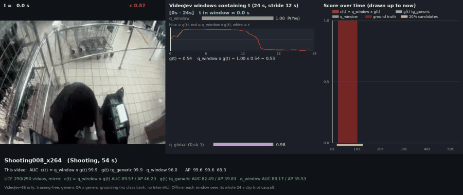
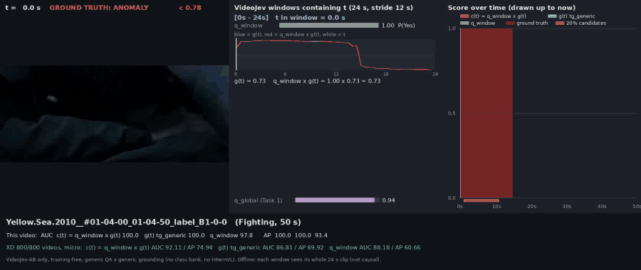

# VideoJevVAD

Video anomaly detection with one model. No training, no labels, no chain of LLMs.

## 1. Overview: one model as the whole system

Most LLM-based VAD uses many steps: caption the clip, ask an LLM for a score, then smooth the scores.
This project replaces that with **one frozen model, VideoJev-4B**, which does both jobs itself.

For each 24 s window (12 s stride, 4 fps), it answers one generic question and one generic grounding query:

| Output | Prompt | Meaning |
|---|---|---|
| `q_window` | "Does this video segment contain a clearly visible unusual, dangerous or harmful incident rather than ordinary activity?" (P of "Yes") | **Is** something wrong in this window? |
| `g(t)` | "A clearly unusual or dangerous incident occurs." | **When** does it happen in this window? |

The anomaly score is their product, averaged over overlapping windows:

```text
c(t) = q_window × g(t)
```

It uses no class names and no event list. Labels are read only for evaluation.
It runs offline: a score can use later frames in the same window, so this is not a causal method.

## 2. Best-case examples

These are the best cases by AUC on a single video. They are not typical: see the table below for full-dataset results.
Left: the video. Middle: the 24 s window at the current time. Right: c(t) over time, with the ground truth in red.





## 3. Results

Frame-level results in %, on the full test sets. **VideoJev-4B** is this project; the other rows are LLM baselines with the original generic prompt.

**UCF-Crime (290 videos)**

| Model | Micro AUC | Micro AP | Macro AUC | Macro AP |
|---|---:|---:|---:|---:|
| **VideoJev-4B, c(t) (ours)** | **89.57** | **46.23** | **82.06** | **62.51** |
| InternVL3.5-1B | 82.64 | 29.86 | 70.27 | 41.37 |
| InternVL3.5-2B | 85.64 | 33.67 | 68.88 | 40.94 |
| InternVL3.5-4B | 85.30 | 33.84 | 68.82 | 41.53 |
| InternVL3.5-8B | 85.85 | 32.99 | 70.25 | 41.83 |
| Qwen3-VL-2B-Instruct | 83.67 | 31.67 | 63.78 | 37.69 |
| Qwen3-VL-4B-Instruct | 83.93 | 33.66 | 66.14 | 38.40 |
| Qwen3.5-2B | 84.19 | 29.94 | 69.34 | 40.40 |
| Qwen3.5-4B | 85.44 | 33.41 | 68.87 | 39.21 |
| LLaVA-NeXT-Video-7B | 52.11 | 9.39 | 55.61 | 32.53 |

**XD-Violence (800 videos)**

| Model | Micro AUC | Micro AP | Macro AUC | Macro AP | Macro AP positive |
|---|---:|---:|---:|---:|---:|
| **VideoJev-4B, c(t) (ours)** | **92.11** | **74.94** | **85.18** | **77.82** | **78.35** |
| InternVL3.5-1B | 85.25 | 51.31 | 59.42 | 53.87 | 54.97 |
| InternVL3.5-2B | 88.15 | 57.91 | 61.98 | 55.40 | 56.47 |
| InternVL3.5-4B | 89.41 | 63.29 | 64.13 | 56.81 | 57.85 |
| InternVL3.5-8B | 89.49 | 63.11 | 65.89 | 57.71 | 58.72 |
| Qwen3-VL-2B-Instruct | 88.48 | 62.99 | 61.02 | 55.14 | 56.22 |
| Qwen3-VL-4B-Instruct | 89.86 | 65.14 | 63.05 | 55.94 | 57.00 |
| Qwen3.5-2B | 89.55 | 65.78 | 62.30 | 55.65 | 56.71 |
| Qwen3.5-4B | 89.71 | 63.35 | 63.31 | 56.08 | 57.14 |

- **Macro** covers videos that contain both normal and abnormal frames (UCF 140, XD 488). **Macro AP positive** also includes the 12 XD videos that are abnormal throughout (500 total). On UCF the two are the same.
- **Sampling differs.** Baselines use 16 frames per 24 s window (fp16). VideoJev-4B uses up to 96 frames per window.
- **No full result:** Qwen3-VL-8B-Instruct (no successful output), LLaVA-NeXT-Video-7B-DPO (not run), LLaVA-NeXT-Video-7B on XD (stopped at 654/800).

**Latency, seconds per window, batch 1**

| Model | UCF model | UCF end-to-end | XD model | XD end-to-end |
|---|---:|---:|---:|---:|
| InternVL3.5-1B | 0.53 | 1.19 | 0.54 | 1.68 |
| InternVL3.5-2B | 0.71 | 1.23 | 0.74 | 1.43 |
| InternVL3.5-4B | 1.27 | 1.57 | 1.53 | 2.12 |
| InternVL3.5-8B | 1.85 | 2.16 | 1.86 | 2.46 |
| Qwen3-VL-2B-Instruct | 0.16 | 0.47 | 0.26 | 1.40 |
| Qwen3-VL-4B-Instruct | 0.32 | 0.95 | 0.43 | 1.64 |
| Qwen3.5-2B | 0.38 | 1.00 | 0.40 | 1.48 |
| Qwen3.5-4B | 0.57 | 1.15 | 0.64 | 1.65 |

These timings come from different GPU and IO conditions, so they are not a controlled benchmark.
VideoJev-4B took about 3.4 s per window end-to-end on UCF (RTX 2080 Ti). That was measured on a run with InternVL-written queries, not on the c(t) run, so it is an approximate figure.

## 4. How to run

**Requirements**

- One GPU with about 11 GB free
- Python 3.12, torch 2.5.1, transformers 5.17, accelerate 1.15, decord 0.6, scikit-learn, Pillow
- flash-linear-attention 0.2.2
- [VideoJev-4B](https://huggingface.co/ZhuYuhan/VideoJev-4B) weights, revision `1c1a253`
- UCF-Crime and XD-Violence, which you download yourself

**Setup**

1. Set the dataset and weight paths at the top of `vj.py`.
2. Set the Python path `PY` and `PYTHONPATH` in `run.sh`.

**Run** (`G` is a GPU id, `DS` is `ucf` or `xd`)

```bash
bash run.sh smoke G                 # quick test on one video
bash run.sh window DS G             # run the model on every window; add more GPU ids to go faster
bash run.sh status                  # check progress
bash run.sh score DS gl_v10 clean   # build c(t)
bash run.sh eval DS gl_v10          # print the metrics
```

Results are written to `outputs/DS/gl_v10/metrics.md`.

To draw a score-only animation of any video:

```bash
python demo.py --dataset ucf --video Shooting008_x264 --out my_scores.gif
```

Other modes and experiments are described in [docs/DETAILS.md](docs/DETAILS.md).
